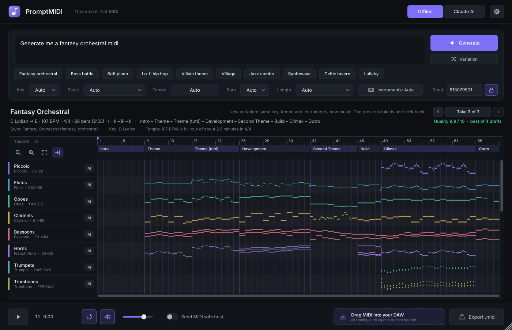

# PromptMIDI

**Describe the music in words, get multi-track MIDI.** PromptMIDI is a VST3 instrument plug-in (plus AU on macOS and a standalone app) with a prompt window: type *"Generate me a fantasy orchestral midi"* or *"Make me a soft piano midi"*, press **Generate**, then drag the result into your DAW.



## What it does

- **Prompt window.** Plain-English requests: genre, mood, instruments, key, tempo, length, time signature. For example:
  - `Generate me a fantasy orchestral midi`
  - `Make me a soft piano midi`
  - `dark lofi beat in F# minor, 80 bpm, no drums`
  - `epic trailer music with choir and harp, 32 bars`
  - `just piano and cello, sad`
  - `celtic tavern jig` (6/8) · `viennese waltz` (3/4) · `30 second synthwave loop at 120 bpm`
- **Two engines:**
  - **Offline** (default): instant, free, no internet. A built-in interpreter recognises 40+ styles (including 12 orchestral game and film archetypes), 20+ moods, 60+ instruments and explicit settings, then a composition engine writes the music.
  - **Claude AI** (optional): Claude reads your prompt and writes the *composition plan* (key, mode, chord progression, instrumentation, registers, playing patterns, arrangement and a main theme). PromptMIDI's engine then writes the notes from that plan, so the MIDI is always valid and playable, even for unusual prompts such as *"music for a dwarven forge at night"*.
- **Different every time:** themes, rhythms and harmony draw on statistics learned from about 28,000 pieces of the Lakh MIDI Dataset (see [Credits and data](#credits-and-data)), forms and orchestration vary from piece to piece, and **Variation** gives genuinely new music (new tune, harmony, form and orchestration) while keeping the key, tempo, length and instruments.
- **Your own instruments:** compose for exactly the instruments you pick, from a single piano, cello or guitar (a solo piece) to any ensemble, each with an automatic or chosen role.
- **A DAW-style editor:** scroll and zoom through the whole piece, see every section, chord and loop point, click the ruler to play from anywhere, and open any track in a note editor to move, resize, add and delete notes (with undo).
- **Complete orchestral game and film cues** (see [Orchestral cues](#orchestral-cues)): 2-4 minute pieces with an intro, theme, developed restatements, a second theme, a build, a climax and an outro, or an end stinger plus loop points for in-game looping. A full orchestra in score order, per-note articulations (with keyswitch or UACC export), runs, swells into tutti hits and separate orchestral percussion. Every generation goes through a quality check.
- **Real arrangements, not random notes:**
  - **Form (songs and loops):** an intro, then 4-bar phrases in A A B A (A B A for three phrases). The B section has its own contrasting harmony, and heroic and epic pieces can lift the final statement of the theme into a new key.
  - **Melody:** themes open with a signature leap, repeat and develop their motif, land on chord tones on the beat, and peak around two-thirds of the way through. Counter-melodies move against the lead, and violins or glockenspiel can double the theme at the climax.
  - **Harmony and orchestration:** voice-led chord voicings that stay out of the mud below C3, and every part kept inside its instrument's real range.
  - **Patterns:** idiomatic writing such as walking bass, Alberti bass, guitar strums, harp arpeggios, string ostinatos and gallops, timpani rolls, pizzicato, house stabs and 808s, plus 20+ drum grooves with fills and crashes.
  - **Expression:** staggered entries, dynamics curves, swing and humanisation. CC1 (dynamics) and CC11 (expression) curves are written on every bowed, blown and sung part, which orchestral sample libraries respond to. On a plain General MIDI synth, CC1 adds vibrato instead.
- **Get the MIDI into your DAW:**
  - **Drag and drop** the whole piece, or a single track from the track list, straight onto your DAW's timeline.
  - **Export .mid**: a type-1 MIDI file with one named track per instrument, GM program changes, tempo, time and key signatures, section markers and loop points.
  - **Articulations for sample libraries:** choose General MIDI (pizzicato and tremolo on their own tracks), **keyswitch notes**, or **controller values** such as Spitfire's UACC (CC32) in **Settings**; the numbers are editable to match your library.
  - **Optional live MIDI output** in time with the host transport ("Send MIDI with host", off by default). When looping, a cue with loop points plays its intro once and then repeats the loop region, the way a game engine would.
- **Built-in preview sound**, so you can hear the result before routing it to your own instruments. It is heard only while you press Play inside PromptMIDI: never during your DAW's playback, and it stops when you drag MIDI out, when the host starts or when the window closes. Bypassing the plug-in ends every note it started.
- **Key / Scale / Tempo / Bars / Length / Instruments** controls re-shape the current result instantly. **Seed** with **Lock** makes results reproducible.
- **Mute** tracks to leave them out of playback and export. Everything is saved with your DAW project. The API key is not.

## The editor


- **Arrangement:** one lane per track beside its header, under a ruler with bar numbers, the sections (Intro, Theme, Development...), the loop region and the chords. Scroll with the wheel (Shift for sideways), zoom with Ctrl / Cmd + wheel or the zoom buttons, **Fit** shows the whole piece, **Follow** keeps the playhead in view.
- **Play from anywhere:** click or drag in the ruler to move the play cursor (the purple marker); Play (or Space) previews from there.
- **Note editor:** click a track to edit it; if the whole piece is in view, the editor zooms in to about twelve bars from the track's first note. Click a note to select it (Shift adds, drag on empty space to lasso), drag to move, drag its end to resize, double-click to add or delete, arrow keys transpose (Shift = octave) or nudge by the grid, Delete removes, Ctrl / Cmd + A selects all, Esc clears the selection and then closes the editor. Ctrl / Cmd + Z undoes and Ctrl / Cmd + Shift + Z (or Y) redoes anywhere in the window (some DAWs keep these keys for themselves; the editor's undo and redo buttons always work). The grid can be 1/4 to 1/32 or off. Clicking a note plays it. Drag the editor's title bar to give it more room. Edits go into the export and the drag-and-drop file, and are saved with your project.
- **Takes:** every Generate and Variation is a new take, and the take you leave is kept with its edits. Step back and forth with the arrows beside **Take 3 of 5**, or click it to pick one from the list. Changing Key, Tempo, Bars, Length or the instruments re-composes the take on screen; if you've edited its notes, the edited version is kept as its own take. The last 20 takes are kept while PromptMIDI is open; your project saves the one on screen.
- **Mute** a track with **M**; drag a track's header into the DAW to get that track alone. Under each track's name: the sound it asks for and the range it plays.
- **If Play does nothing:** the preview needs audio running. In the standalone app choose an output in Options > Audio/MIDI Settings; in a DAW check that its audio engine is on and the plug-in isn't bypassed. PromptMIDI says which in the status line.

## Your own instruments

Click **Instruments** and choose **My instruments** (or **Customise these** to start from the instruments the piece on screen uses), then add instruments by category (orchestral sections, woodwinds, brass, percussion, keys, guitars and bass, synths, solo and world instruments) or start from a preset (solo piano, string quartet, woodwind quintet, rock band, jazz trio...). Each instrument's role can be left on **Auto** or set (melody, counter-melody, chords, pad, arpeggio, bass, ostinato). The prompt still sets the style, mood, key and tempo.

- **One instrument:** a piano, harp or guitar plays melody and accompaniment on one track; a melodic instrument (flute, cello, violin...) plays the tune.
- **Auto roles** follow an arranger's habits: the most melodic instrument takes the tune, a bass instrument (or the lowest of three or more) the bass, keyboards and guitars the chords, harps and mallets the arpeggios, string sections and choir the pads.
- **Three or more instruments in an orchestral style** get a full cue; smaller groups and other styles are composed as pieces of the chosen **Length**.
- In **Claude AI** mode the list is sent with the request and the plan is rebuilt around it.

## Orchestral cues

Any orchestral, cinematic or game-score prompt (*"Generate me a fantasy orchestral midi"*, *"boss battle"*, *"celtic orchestral"*, *"stealth music"*...) is composed as a complete cue rather than a loop.

- **Length:** set with the **Length** control or in the prompt. *Sketch* is 16 bars, *Cue* about a minute, *Full* (the default) about two and a half minutes, *Extended* about four minutes. A bar count or duration in the prompt (`64 bars`, `3 minutes`) is used as given.
- **Form:** Intro, Theme, Theme (tutti), Development, Second Theme, Build, Climax and Outro, scaled to the length (long cues go through a second development and build to a bigger final climax). Asking for a **loop** (`battle loop`, `seamless`) ends the cue with a short **end stinger** and marks a loop region from the theme to the stinger. Sections and loop points are written into the MIDI file as markers and cue points, and are shown in the piano roll.
- **Harmony:** phrase-level progressions with half and authentic cadences, secondary dominants, borrowed chords, tonic and dominant pedal points, a descending-fifths sequence in the development, a second theme in a related key, and a key lift for the climax. Restatements of the theme are **reharmonised** around the tune (in the mode's own chords, so Dorian keeps its major IV and Mixolydian its flat VII), and epic bVI-bVII-I cadences are used only where the melody fits them.
- **Thematic development:** the theme comes back in different instruments, in augmentation in the intro and outro, and in the development as a **sequence that follows the harmony** (the motif keeps its relationship to each chord), then **fragmented** to its head and **liquidated** before the retransition. Builds pass the rising head between two instruments (call and response), and counter-lines move in real counterpoint against the theme (chord tones on the beat, stepwise passing notes, moving while the theme holds).
- **Orchestration:** a full orchestra in score order (woodwinds, brass, timpani, percussion, harp / celesta / glockenspiel, choir, soloists, Violins I, Violins II, Violas, Celli, Basses), each part in its practical range. Each section decides who carries the theme, who doubles it (violins in octaves, flutes and oboes with the tutti theme, piccolo and glockenspiel on top at the climax), which woodwind answers the theme in the development, where the woodwinds add their own chords, who plays the counter-line, the harmony (voiced across the section, with divisi), the rhythmic engine (spiccato ostinati, pizzicato, harp) and the bass.
- **Articulations:** every note carries one: legato, sustain, staccato, spiccato, marcato, pizzicato, tremolo, trill. Export them as keyswitches or controller values (see below), or as separate pizzicato / tremolo tracks for General MIDI.
- **Transitions:** timpani rolls and suspended-cymbal swells into tutti hits (bass drum, crash, tam-tam in dark music, a marcato brass and low-string chord), snare rolls, string and flute runs, and harp glissandi with the pedals set to the chord.
- **Percussion:** separate orchestral instruments (Bass Drum, Cymbals, Snare Drum, Taiko Ensemble, Tam-tam, Triangle), not one General MIDI drum kit.
- **Quality check on every generation:** each cue is composed four times (three for other music) with different seeds; each draft is repaired (notes folded into range, stray chord notes moved to chord tones) and scored for out-of-range notes, wrong harmony notes, strong-beat clashes, low-register mud and the shape of the melody. The best draft wins, and its score is shown under the title (hover for the details).

### Articulation export

**Settings > MIDI export > Articulations**:

| Option | What the exported / dragged MIDI contains |
|---|---|
| General MIDI | Pizzicato and tremolo passages on their own tracks (`Violins I (pizz.)`), with GM programs 45 and 44. Plays correctly on any GM synth. |
| Keyswitch notes | Each section on one track, with a short keyswitch note just before every change of articulation. Defaults: sustain 12, legato 13, staccato 14, spiccato 15, marcato 16, pizzicato 17, tremolo 18, trill 19 (MIDI 12-19, C-1 to G-1, below every orchestral instrument). |
| Controller | The same, but a controller value instead of a note. The defaults follow Spitfire's UACC chart on CC32: long 1, legato 20, staccato 40, spiccato 42, marcato 52, pizzicato 56, tremolo 11, trill (major 2nd) 71. |

Libraries differ, so check your library's articulation list and edit the eight numbers (`-1` = don't send). Live MIDI output stays General MIDI.

## Download

Every push builds Windows, macOS (Universal) and Linux binaries in GitHub Actions: open the **Actions** tab, select the latest **Build** run and download the `PromptMIDI-<OS>` artifact.

Install the plug-in by copying `PromptMIDI.vst3` to:

| OS | VST3 folder |
|---|---|
| Windows | `C:\Program Files\Common Files\VST3\` |
| macOS | `/Library/Audio/Plug-Ins/VST3/` (AU: `PromptMIDI.component` into `/Library/Audio/Plug-Ins/Components/`) |
| Linux | `~/.vst3/` |

On macOS the CI builds are only ad-hoc signed. If macOS blocks them, run `xattr -dr com.apple.quarantine /Library/Audio/Plug-Ins/VST3/PromptMIDI.vst3` (and the same for the `.component`).

Then rescan plug-ins in your DAW. PromptMIDI shows up as an **instrument** (category *Instrument | Generator*).

## Using it in your DAW

PromptMIDI is an instrument that also sends MIDI out, so you can use it in two ways:

1. **Generate, then drag** *(works in every DAW, including Ableton Live, Logic, FL Studio, Studio One, Cubase, Reaper and Bitwig)*. Load PromptMIDI on any track, generate, then drag from **Drag MIDI into your DAW** onto your timeline. Most DAWs split a multi-track file into one track per instrument. To drag a single part, drag its row in the track list.
2. **Play it live as MIDI.** Turn on **Send MIDI with host** and PromptMIDI sends the piece out as MIDI (one channel per track, looping, from bar 1) whenever the host plays. It never makes sound itself during host playback. Route its MIDI output to your instruments:
   - **Reaper:** add a MIDI send from the PromptMIDI track to your instrument track(s).
   - **Cubase / Nuendo:** set an instrument or MIDI track's input to *PromptMIDI*.
   - **Bitwig:** use a *Note Receiver* on the destination track.
   - **FL Studio:** set an output port in the wrapper's MIDI settings and the same port on the target instrument.
   - **Ableton Live and Logic** don't accept MIDI from VST3/AU instruments, so use drag and drop there.

Use **Play** to preview inside PromptMIDI. By default PromptMIDI is completely silent while your DAW plays, so after dragging the MIDI to a track you only hear that track.

## Prompt guide (offline engine)

| You can say | Examples |
|---|---|
| Genre | fantasy, orchestral, epic, trailer, piano, classical, baroque, jazz, lofi, hip hop, trap, house, techno, trance, drum and bass, pop, rock, metal, ambient, synthwave, celtic, folk, horror, chiptune, bossa nova, funk, disco, blues, lullaby, japanese, arabian, march, waltz, r&b, soul, reggae, country, hymn |
| Game and film cues | heroic main theme, boss battle, chase / action, stealth, lament / death scene, exploration / ruins, village / pastoral, space / sci-fi, whimsical / wizard school, villain / dark fantasy, victory fanfare, pirate / high seas |
| Orchestrate any genre | add *orchestral* (or *orchestra*, *symphonic*, *cinematic*): `celtic orchestral`, `orchestral march`, `arabian desert orchestral theme`. The genre keeps its scale, meter and signature instruments (fiddle, shakuhachi, oud...), which join a full orchestra: strings, woodwinds, horns, and for energetic or martial music trumpets, trombones, tuba, timpani and percussion. |
| Mood | soft, calm, energetic, epic, heroic, sad, emotional, happy, dark, mysterious, dreamy, romantic, tense, jazzy, groovy, simple, complex, slow, fast, building, fading |
| Instruments | piano, rhodes, strings, violin, cello, harp, choir, flute, clarinet, oboe, trumpet, horns, brass, sax, guitar, nylon guitar, bass, 808, synth, pad, organ, music box, celesta, marimba, koto, sitar, bagpipes, steel drums, drums, taiko, and more |
| Remove things | `no drums`, `without bass`, `no piano` |
| Only what you name | `only piano and cello`, `just strings`, `solo violin` |
| Key / scale | `in D minor`, `C# major`, `key of Eb`, `f sharp minor`, `dorian`, `harmonic minor`, `pentatonic` |
| Tempo | `120 bpm`, `tempo 90`, or words like *slow* and *fast* |
| Length | `16 bars`, `8-bar`, `30 seconds`, `2 minutes`, `short`, `long`, `loop`; for orchestral cues also `sketch`, `cue`, `full`, `extended` |
| Meter | `3/4`, `6/8`, `12/8`, `waltz`, `jig` |

If no genre is recognised, PromptMIDI falls back to a cinematic piano-and-strings arrangement. The line under the title always shows how the prompt was understood.

## Claude AI mode

1. Click **Claude AI**, then **Settings**.
2. Paste an Anthropic API key. You can also leave the field empty and set the `ANTHROPIC_API_KEY` environment variable instead.
3. Optionally change the model (default `claude-opus-5-5`) and the effort (Low is fastest, High is the most considered).

Notes:

- Requests use the Messages API with **structured outputs**: Claude must return JSON that matches PromptMIDI's plan schema, so the answer is always machine-readable. The plug-in also opts in to server-side **refusal fallbacks** (`fallbacks: "default"`) on models that support them. Transient errors (rate limits, overload) are retried twice with back-off. A request can be cancelled at any time.
- For orchestral requests Claude plans a full cue: it sets `orchestral` and `length`, lists the orchestra section by section (up to 24 tracks) and names the instrument that states the theme; the cue engine does the rest.
- One request per **Generate**. **Variation** and the Key/Tempo/Bars controls reuse the plan without calling the API again. A new **Scale** asks for a fresh plan on the next Generate, because Claude's harmony was written for the old scale.
- The key is stored only on your computer, in the PromptMIDI settings file (`%APPDATA%\PromptMIDI` on Windows, `~/Library/Application Support/PromptMIDI` on macOS, `~/.config/PromptMIDI` on Linux), and is sent only to `api.anthropic.com`. It is never written into DAW projects. Requests are billed to your Anthropic account.

## Building from source

Requirements: CMake 3.22+, a C++17 compiler (Visual Studio 2022, Xcode 14+, GCC 11+ or Clang 14+). JUCE 9.0.6 is downloaded automatically.

```bash
cmake -S . -B build -DCMAKE_BUILD_TYPE=Release
cmake --build build --config Release --parallel
ctest --test-dir build -C Release --output-on-failure
```

Outputs are in `build/PromptMIDI_artefacts/Release/` (`VST3/`, `Standalone/` and `AU/` on macOS). To copy the VST3 into your system plug-in folder automatically, configure with `-DPROMPTMIDI_COPY_PLUGIN=ON`. To use an existing JUCE checkout instead of downloading one, add `-DPROMPTMIDI_JUCE_DIR=/path/to/JUCE`.

On Linux, first install the JUCE dependencies:

```bash
sudo apt install libasound2-dev libx11-dev libxrandr-dev libxinerama-dev libxcursor-dev libxext-dev \
  libxcomposite-dev libxi-dev libfreetype-dev libfontconfig1-dev libcurl4-openssl-dev libgl1-mesa-dev
```

The engine alone has no dependencies. `-DPROMPTMIDI_BUILD_PLUGIN=OFF` builds just the engine, its tests and a command-line tool:

```bash
./build/promptmidi-cli "Generate me a fantasy orchestral midi" -o fantasy.mid
./build/promptmidi-cli "soft piano in D minor, 70 bpm" --seed 7 --notes
```

### Tests

- `core_tests`: chord parsing, prompt interpretation, composer invariants (no overlapping notes, ranges, determinism, melody lands on chord tones, endings resolve), MIDI file validity; every style is checked with several seeds and meters. For cues: lengths, forms, loop points and markers; 15 orchestral prompts x 3 seeds must pass the quality check (score 8.5+, no wrong harmony notes, nothing out of range, little clash and mud); the full orchestra, articulations, keyswitch and UACC export; and that themes are developed (passed between instruments, restatements reharmonised).
- `json_tests`: the plan schema is valid for structured outputs; spec and composition JSON round trips (including articulations, chord tones, pedals, markers, loop points and quality, and states saved by older versions); Claude request bodies, headers and response, refusal and error handling; an orchestral plan from Claude becomes a full cue.
- `vst3_host_test`: loads the built `PromptMIDI.vst3` through JUCE's VST3 hosting, restores a project state, runs the transport and checks that PromptMIDI is silent and sends nothing while the host plays (by default), that "Send MIDI with host" sends notes but no audio, that bypassing ends every note, that a looping cue keeps cycling through its loop region past the end, and the saved state.
- `editor_tests`: the plug-in in-process: note edits with undo and redo (including Ctrl / Cmd + Z from the window), Variation, the take history, your own instruments, the preview stopping when the host plays, note audition, the play cursor, and the arrangement view (zooming in when the note editor opens, Esc closing it).
- Core tests also cover the learned models, that variations differ (harmony and tune), and custom ensembles (solo piano on one track, duos, bands, orchestras, user-set roles).

`promptmidi_ui_snapshot out.png "prompt" [scale] [width] [height] [track] [zoom]` renders the editor to a PNG without a display (the screenshots above were made this way).

`Tools/variety.py build/promptmidi-cli` measures how alike repeated generations and variations are (theme, contour, rhythm, harmony, form and lead instruments).

`Tools/evaluate_orchestral.py` generates 20 orchestral game cues (`python3 Tools/evaluate_orchestral.py build/promptmidi-cli out/`). It measures each one against a checklist of what a professional score does: sections present, instrument ranges, strong-beat dissonance, low-register mud, outer-voice parallels, the theme's shape, form, length and dynamics, articulations, divisi, runs, swell-and-hit transitions, and thematic development (where the motif returns, fragmentation, imitation, reharmonised restatements). It prints a score per dimension, plus the original v1 checklist for comparison. The scores are heuristics that point at weaknesses; they are not a substitute for listening.

## Project layout

```
Source/Core/     Engine: plain C++17, no JUCE
  MusicTheory    modes, roman-numeral / chord-name parsing, voicing helpers
  StyleSpec      the composition plan (what Claude returns, what the interpreter builds)
  PromptInterpreter  offline prompt -> plan (styles, moods, instruments, explicit settings)
  Composer       plan -> notes (harmony, melody, accompaniment patterns, drums); best-of-N takes
  CueEngine      orchestral cues: form, phrase harmony, thematic development, orchestration, transitions
  QualityCheck   the check every generation goes through, and the repair pass
  Learned        uses the corpus statistics (LearnedData, generated) for rhythms, intervals and progressions
  MidiFileWriter notes -> Standard MIDI File (markers, loop points, keyswitch / CC articulations)
Source/Plugin/   JUCE plug-in: processor, editor, arrangement and note editor (Timeline), instrument picker,
                 preview synth, Claude client, JSON
Resources/Fonts/ the Inter typeface (SIL Open Font License)
Tests/           unit tests and the VST3 host test
Tools/           command-line generator, UI snapshot tool, evaluators, and corpus/ (the learning script)
```

## Credits and data

- **Corpus statistics** (`Source/Core/LearnedData.cpp`) were learned by `Tools/corpus/learn_from_midicaps.py` from the [MidiCaps](https://huggingface.co/datasets/amaai-lab/MidiCaps) dataset (Melechovsky, Roy and Herremans, 2024, CC BY-SA 4.0), which annotates the [Lakh MIDI Dataset](https://colinraffel.com/projects/lmd/) (Colin Raffel, 2016, CC BY 4.0). Only aggregate counts are stored (interval transitions of lead lines, bar rhythm patterns, four-chord progressions per style family), never a melody or a piece. That file is licensed CC BY-SA 4.0. To regenerate it, download `train.json` and `midicaps.tar.gz` from the dataset page and run the script.
- **Inter** typeface by The Inter Project Authors, [SIL Open Font License 1.1](Resources/Fonts/Inter-OFL.txt).

## License note

PromptMIDI is built on [JUCE](https://juce.com), which is dual-licensed under AGPLv3 and a commercial licence. If you distribute builds of this plug-in, you must either release your source under the AGPLv3 or hold a JUCE commercial licence. VST is a trademark of Steinberg Media Technologies GmbH.
