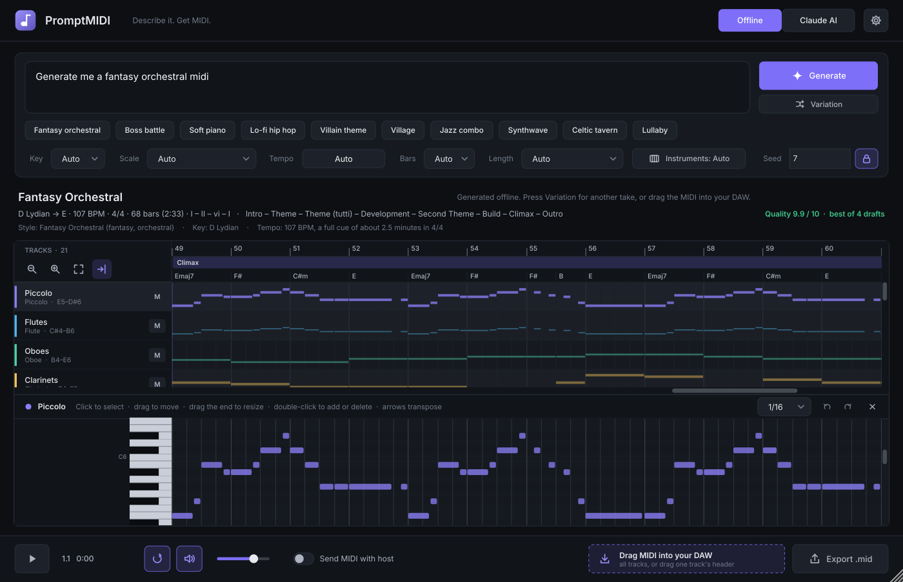

# PromptMIDI

**Describe the music in words, get multi-track MIDI.** PromptMIDI is a VST3 instrument plug-in (plus AU on macOS and a standalone app) with a prompt window: type *"Generate me a fantasy orchestral midi"* or *"Make me a soft piano midi"*, press **Generate**, then drag the result into your DAW.


## What it does

- **Prompt window.** Plain-English requests: genre, mood, instruments, key, tempo, length, time signature. For example:
  - `Generate me a fantasy orchestral midi`
  - `Make me a soft piano midi`
  - `dark lofi beat in F# minor, 80 bpm, no drums`
  - `epic trailer music with choir and harp, 32 bars`
  - `just piano and cello, sad`
  - `celtic tavern jig` (6/8) · `viennese waltz` (3/4) · `30 second synthwave loop at 120 bpm`
- **Two engines:**
  - **Offline** (default): instant, free, no internet. A built-in interpreter recognises 40+ styles (including 12 orchestral game and film archetypes), 20+ moods, 60+ instruments and explicit settings, then a composition engine writes the music.
  - **Claude AI** (optional): Claude reads your prompt and writes the *composition plan* (key, mode, chord progression, instrumentation, registers, playing patterns, arrangement and a main theme). PromptMIDI's engine then writes the notes from that plan, so the MIDI is always valid and playable, even for unusual prompts such as *"music for a dwarven forge at night"*.
- **It thinks before it answers:** instead of handing back its first idea, PromptMIDI reads the prompt into several different plans (keys, tempos, harmony, orchestration, all within what you asked for), writes hundreds of drafts, develops the most promising, and keeps the one that meets every criterion and a musician's judgement rates highest. A panel shows each stage with a live timer, the best draft so far, **Use best so far** and **Cancel**. See [Thinking](#thinking).
- **It does what you asked:** every prompt becomes a list of criteria (*only piano*, *a trio*, *the tenor sax plays the melody*, *no drums*, *D minor*, *140 BPM*, *about 30 seconds*, *3/4*, *soft*...). The plan is built to meet them, every draft is checked against them, and the plug-in shows the result: *Matches your request 5/5*, with each criterion on hover. See [Does it match the request?](#does-it-match-the-request).
- **New music, never a copy:** the engine learned only statistics from its reference corpus (no melody or piece is stored), and every generated tune is also checked against fingerprints of the corpus's melodies, so nothing it writes reproduces a passage of a downloaded MIDI file. Each Variation is also checked against your earlier takes. See [Originality](#originality).
- **Different every time:** themes, rhythms and harmony draw on statistics learned from about 28,000 pieces of the Lakh MIDI Dataset (see [Credits and data](#credits-and-data)), forms and orchestration vary from piece to piece, and **Variation** gives genuinely new music (new tune, harmony, form and orchestration) while keeping the key, tempo, length and instruments.
- **Your own instruments:** compose for exactly the instruments you pick, from a single piano, cello or guitar (a solo piece) to any ensemble, each with an automatic or chosen role.
- **A DAW-style editor:** scroll and zoom through the whole piece, see every section, chord and loop point, click the ruler to play from anywhere, and open any track in a note editor to move, resize, add and delete notes (with undo).
- **Complete orchestral game and film cues** (see [Orchestral cues](#orchestral-cues)): 2-4 minute pieces with an intro, theme, developed restatements, a second theme, a build, a climax and an outro, or an end stinger plus loop points for in-game looping. A full orchestra in score order, per-note articulations (with keyswitch or UACC export), runs, swells into tutti hits and separate orchestral percussion. Every generation goes through a quality check.
- **Real arrangements, not random notes:**
  - **Form (songs and loops):** an intro, then 4-bar phrases in A A B A (A B A for three phrases). The B section has its own contrasting harmony, and heroic and epic pieces can lift the final statement of the theme into a new key.
  - **Melody:** themes open with a signature leap, repeat and develop their motif, land on chord tones on the beat, and peak around two-thirds of the way through. Counter-melodies move against the lead, and violins or glockenspiel can double the theme at the climax.
  - **Harmony and orchestration:** voice-led chord voicings that stay out of the mud below C3, and every part kept inside its instrument's real range.
  - **Patterns:** idiomatic writing such as walking bass, Alberti bass, guitar strums, harp arpeggios, string ostinatos and gallops, timpani rolls, pizzicato, house stabs and 808s, plus 20+ drum grooves with fills and crashes.
  - **Expression:** staggered entries, dynamics curves, swing and humanisation. CC1 (dynamics) and CC11 (expression) curves are written on every bowed, blown and sung part, which orchestral sample libraries respond to. On a plain General MIDI synth, CC1 adds vibrato instead.
- **Get the MIDI into your DAW:**
  - **Drag and drop** the whole piece, or a single track from the track list, straight onto your DAW's timeline.
  - **Export .mid**: a type-1 MIDI file with one named track per instrument, GM program changes, tempo, time and key signatures, section markers and loop points.
  - **Articulations for sample libraries:** choose General MIDI (pizzicato and tremolo on their own tracks), **keyswitch notes**, or **controller values** such as Spitfire's UACC (CC32) in **Settings**; the numbers are editable to match your library.
  - **Optional live MIDI output** in time with the host transport ("Send MIDI with host", off by default). When looping, a cue with loop points plays its intro once and then repeats the loop region, the way a game engine would.
- **Hear the real instruments:** the preview plays the piece through a General MIDI sample set (GeneralUser GS): piano, strings, brass, woodwinds, choir, guitars, synths and drum kits, with a little room reverb. You can also use your own `.sf2` SoundFont, or the light sketch synth (**Settings > Preview sound**). It is heard only while you press Play inside PromptMIDI: never during your DAW's playback, and it stops when you drag MIDI out, when the host starts or when the window closes. Bypassing the plug-in ends every note it started.
- **Presets, MIDI in and out:** save a piece with its prompt, settings and edits as a preset, load it again or share it (`.promptmidi` files), start from 16 factory presets, and **import any MIDI file** (from the Presets menu, or by dropping it on the window) to view, edit, preview and drag it out again, or press Variation for new music for its instruments. See [Presets and MIDI files](#presets-and-midi-files).
- **Key / Scale / Tempo / Bars / Length / Instruments** controls re-shape the current result instantly. **Seed** with **Lock** makes results reproducible.
- **Mute** tracks to leave them out of playback and export. Everything is saved with your DAW project. The API key is not.

## Thinking

Press **Generate** (or **Variation**) and PromptMIDI works on the request before it answers, the way you'd sketch a few ideas, try each one and keep the best:

1. **Reading your prompt:** the literal reading first (style, mood, instruments, key, tempo, length).
2. **Sketching plans:** 16 different readings within what you asked for: other keys, tempos, chord progressions and orchestrations. Anything you specified (instruments, key, tempo, length, meter, dynamics) is kept in every plan.
3. **Writing drafts:** drafts of every plan. Each one is checked against your request and for craft, then judged.
4. **Developing the best ideas:** the four most promising plans get more drafts, and so do variations of them (other harmony and accompaniment figures).
5. **Final check:** the winner must meet every criterion. Then it's judged as a whole, and the reasoning is kept.

**The judge** (`Source/Core/Judge.h`) listens like a musician, on top of the request and craft checks (range, chord tones, clashes, muddy low notes):
- **Melody:** a climax late in the tune, a motif that comes back, leaps that turn back by step, more than one rhythm, a held last note on the tonic.
- **Harmony:** enough different chords, a cadence home (V–I or IV–I), the bass on chord tones.
- **Balance:** the tune audible above the accompaniment, with the parts spread across registers.
- **Mood:** how busy and how loud, against the energy of the mood you asked for.
- **Shape:** the dynamic arc (builds, peaks, settles, or stays level, as planned).

Hover over the verdict under the title to see how the take was chosen: the plan, the draft, its score on each aspect, and how the other drafts compared.

**Settings > Thinking** sets how long it works on a request:

| | Drafts | Time (typical / longest cue) |
|---|---|---|
| Quick | a few, of the first plan | instant |
| Thorough (default) | 296, over 16 plans and 8 variations | about 0.5 s / 4 s |
| Deep | 960, over 32 plans and 16 variations | about 2 s / 10 s |

Measured over 72 generations (24 prompts × 3 seeds), every result met every criterion at all three depths. Quick averaged 92.2/100 on the judge and 9.46/10 on the quality check, Thorough 95.9 and 9.79, Deep 96.1 and 9.83. Thinking is deterministic: the same prompt, settings, seed and depth give the same piece, so **Lock** still reproduces a take. The Key, Tempo and other controls re-compose the chosen draft instantly, without thinking again. With **Claude AI**, Claude writes the plan and PromptMIDI then thinks about how to write it: every draft goes to Claude's plan.

## The editor



- **Arrangement:** one lane per track beside its header, under a ruler with bar numbers, the sections (Intro, Theme, Development...), the loop region and the chords. Scroll with the wheel (Shift for sideways), zoom with Ctrl / Cmd + wheel or the zoom buttons, **Fit** shows the whole piece, **Follow** keeps the playhead in view.
- **Play from anywhere:** click or drag in the ruler to move the play cursor (the purple marker); Play (or Space) previews from there.
- **Note editor:** click a track to edit it; if the whole piece is in view, the editor zooms in to about twelve bars from the track's first note. Click a note to select it (Shift adds, drag on empty space to lasso), drag to move, drag its end to resize, double-click to add or delete, arrow keys transpose (Shift = octave) or nudge by the grid, Delete removes, Ctrl / Cmd + A selects all, Esc clears the selection and then closes the editor. Ctrl / Cmd + Z undoes and Ctrl / Cmd + Shift + Z (or Y) redoes anywhere in the window (some DAWs keep these keys for themselves; the editor's undo and redo buttons always work). The grid can be 1/4 to 1/32 or off. Clicking a note plays it. Drag the editor's title bar to give it more room. Edits go into the export and the drag-and-drop file, and are saved with your project.
- **Takes:** every Generate and Variation is a new take, and the take you leave is kept with its edits. Step back and forth with the arrows beside **Take 3 of 5**, or click it to pick one from the list. Changing Key, Tempo, Bars, Length or the instruments re-composes the take on screen; if you've edited its notes, the edited version is kept as its own take. The last 20 takes are kept while PromptMIDI is open; your project saves the one on screen.
- **Mute** a track with **M**; drag a track's header into the DAW to get that track alone. Under each track's name: the sound it asks for and the range it plays.
- **If Play does nothing:** the preview needs audio running. In the standalone app choose an output in Options > Audio/MIDI Settings; in a DAW check that its audio engine is on and the plug-in isn't bypassed. PromptMIDI says which in the status line.

## Presets and MIDI files

The **Presets** button (top right) has everything for getting things in and out:

- **Save preset...** stores the prompt, the engine, the Key / Scale / Tempo / Bars / Length / Instruments settings and, if there is one, the piece itself with your note edits and mutes, as a `.promptmidi` file in `Documents/PromptMIDI/Presets`. **Your presets** lists them; loading one brings the piece back exactly, as a new take.
- **Factory presets**: 16 starting points (fantasy cue, boss battle, villain's castle, solo piano ballad, string quartet, lo-fi beat, late-night jazz, synthwave, celtic tavern...). They hold a prompt and a length and are composed fresh each time you load them.
- **Import a preset or MIDI file...**: a `.promptmidi` preset from someone else, or any Standard MIDI File. Dropping either onto the PromptMIDI window does the same. An imported MIDI file becomes a new take: its tracks (split by channel), instruments, notes, sustain and expression, tempo, meter, key and markers. You can play it through the preview, mute tracks, edit notes, drag it into your DAW, or press **Variation** for new music for the same instruments, key and tempo.
- **Export this preset...** and **Export MIDI...** save copies wherever you like.

## Your own instruments

Click **Instruments** and choose **My instruments** (or **Customise these** to start from the instruments the piece on screen uses), then add instruments by category (orchestral sections, woodwinds, brass, percussion, keys, guitars and bass, synths, solo and world instruments) or start from a preset (solo piano, string quartet, woodwind quintet, rock band, jazz trio...). Each instrument's role can be left on **Auto** or set (melody, counter-melody, chords, pad, arpeggio, bass, ostinato). The prompt still sets the style, mood, key and tempo.

- **One instrument:** a piano, harp or guitar plays melody and accompaniment on one track; a melodic instrument (flute, cello, violin...) plays the tune.
- **Auto roles** follow an arranger's habits: the most melodic instrument takes the tune, a bass instrument (or the lowest of three or more) the bass, keyboards and guitars the chords, harps and mallets the arpeggios, string sections and choir the pads.
- **Three or more instruments in an orchestral style** get a full cue; smaller groups and other styles are composed as pieces of the chosen **Length**.
- In **Claude AI** mode the list is sent with the request and the plan is rebuilt around it.

## Does it match the request?

Every prompt (and every control you set) becomes a set of criteria. The plan is built to meet them, the finished notes are checked against them, and drafts that miss one are composed again with other seeds before PromptMIDI settles. The result shows under the title (*Matches your request 5/5*); hover over it for each criterion, with what was found when one isn't met.

| You ask for | The piece must |
|---|---|
| `a piano piece`, `sad piano ballad`, `waltz for piano`, `epic choir and organ`, `just drums`, `solo cello` | use only those instruments, and every one of them must play |
| `lo-fi beat with a mellow electric piano`, `orchestral theme with woodwinds and harp` | keep the style's own arrangement and include those instruments |
| `jazz combo with a tenor sax lead`, `guitar solo` | give that instrument the melody |
| `jazz piano trio`, `cello and piano duet`, `string quartet`, `woodwind quintet` | have that many players (a jazz trio drops the sax; a string trio is violin, viola and cello; a woodwind quintet has its horn) |
| `no drums`, `without percussion`, `rock song with no guitar` | leave them out (percussion includes timpani and mallets) |
| `in D minor`, `dorian`, `sad` / `happy` | be in that key, scale, or a minor / major key |
| `140 bpm`, `slow`, `fast` | have that tempo (slow: 100 BPM or less; fast: 116 or more) |
| `30 seconds`, `2 minutes`, `16 bars`, `short`, `long`, the Length control | last that long (the tempo is nudged a little so the length lands on time) |
| `waltz`, `3/4`, `jig`, `6/8` | be in that meter |
| `soft`, `gentle` / `loud`, `powerful` | play softly / strongly |

Instruments named on their own, with no band, orchestra or genre bringing its own (*"sad piano ballad"*, *"happy ukulele song"*, *"funky bass and drums"*), are the whole ensemble. Instruments added with *with*, *featuring* or *plus*, or orchestral sections named in an orchestral style (*"heroic theme, triumphant brass and strings"*), join the style's arrangement. Your own instruments (the **Instruments** button) are always the whole ensemble. Plans from **Claude AI** are held to the same criteria. In the CLI, the criteria are printed after each generation.

## Originality

PromptMIDI composes; it never retrieves. The reference corpus (the MIDI files listed under [Credits and data](#credits-and-data)) was used only to learn statistics: how often a melody steps or leaps after a given move, common one-bar rhythms, common four-chord progressions. No melody, part or piece from it is stored in the plug-in, so it cannot play one back.

Every generation is checked as well:

- **Against the corpus.** The melodies of the files the statistics were learned from (24,462 usable lead lines) are stored as fingerprints in a Bloom filter (`Source/Core/OriginalityData.cpp`, 1.7 MB of hashed bits, built by `Tools/corpus/build_originality_index.py`): runs of ten melodic moves (interval and rhythm), so a passage is recognised in any key or tempo. Common figures don't count: runs found in more than 20 of the 136,982 downloaded lead lines (scales, stock figures; the threshold allows for the several versions of popular songs in the Lakh set), runs of mostly repeated notes, and runs that repeat one short cell (an ostinato). If three or more fingerprints of a melodic part turn up close together, the draft fails the *Original melody* criterion and another is composed. In tests the check catches 90% of whole corpus tunes played back to it (transposed), and flags none of PromptMIDI's own melodic parts.
- **Against your other takes.** A Variation shares little of its melody with the takes before it; if one repeats more than 40% of an earlier take's melodic runs, PromptMIDI composes another (and shows *Different from your other takes*).

`Tools/corpus/audit_originality.py` repeats the corpus check exactly (not through the filter) against every downloaded file. Run on 300 generations across 20 prompts, against all 136,982 usable lead lines of the 168,385 downloaded files: no melodic part shared more than 3 fingerprints with any one file, and no tune was among the closest matches (the closest was a 13-note half-note neighbour figure in a trombone accompaniment).

## Orchestral cues

Any orchestral, cinematic or game-score prompt (*"Generate me a fantasy orchestral midi"*, *"boss battle"*, *"celtic orchestral"*, *"stealth music"*...) is composed as a complete cue rather than a loop.

- **Length:** set with the **Length** control or in the prompt. *Sketch* is 16 bars, *Cue* about a minute, *Full* (the default) about two and a half minutes, *Extended* about four minutes. A bar count or duration in the prompt (`64 bars`, `3 minutes`) is used as given.
- **Form:** Intro, Theme, Theme (tutti), Development, Second Theme, Build, Climax and Outro, scaled to the length (long cues go through a second development and build to a bigger final climax). Asking for a **loop** (`battle loop`, `seamless`) ends the cue with a short **end stinger** and marks a loop region from the theme to the stinger. Sections and loop points are written into the MIDI file as markers and cue points, and are shown in the piano roll.
- **Harmony:** phrase-level progressions with half and authentic cadences, secondary dominants, borrowed chords, tonic and dominant pedal points, a descending-fifths sequence in the development, a second theme in a related key, and a key lift for the climax. Restatements of the theme are **reharmonised** around the tune (in the mode's own chords, so Dorian keeps its major IV and Mixolydian its flat VII), and epic bVI-bVII-I cadences are used only where the melody fits them.
- **Thematic development:** the theme comes back in different instruments, in augmentation in the intro and outro, and in the development as a **sequence that follows the harmony** (the motif keeps its relationship to each chord), then **fragmented** to its head and **liquidated** before the retransition. Builds pass the rising head between two instruments (call and response), and counter-lines move in real counterpoint against the theme (chord tones on the beat, stepwise passing notes, moving while the theme holds).
- **Orchestration:** a full orchestra in score order (woodwinds, brass, timpani, percussion, harp / celesta / glockenspiel, choir, soloists, Violins I, Violins II, Violas, Celli, Basses), each part in its practical range. Each section decides who carries the theme, who doubles it (violins in octaves, flutes and oboes with the tutti theme, piccolo and glockenspiel on top at the climax), which woodwind answers the theme in the development, where the woodwinds add their own chords, who plays the counter-line, the harmony (voiced across the section, with divisi), the rhythmic engine (spiccato ostinati, pizzicato, harp) and the bass.
- **Articulations:** every note carries one: legato, sustain, staccato, spiccato, marcato, pizzicato, tremolo, trill. Export them as keyswitches or controller values (see below), or as separate pizzicato / tremolo tracks for General MIDI.
- **Transitions:** timpani rolls and suspended-cymbal swells into tutti hits (bass drum, crash, tam-tam in dark music, a marcato brass and low-string chord), snare rolls, string and flute runs, and harp glissandi with the pedals set to the chord.
- **Percussion:** separate orchestral instruments (Bass Drum, Cymbals, Snare Drum, Taiko Ensemble, Tam-tam, Triangle), not one General MIDI drum kit.
- **Quality check on every generation:** each cue is composed four times (three for other music) with different seeds; each draft is repaired (notes folded into range, stray chord notes moved to chord tones) and scored for out-of-range notes, wrong harmony notes, strong-beat clashes, low-register mud and the shape of the melody. The best draft wins, and its score is shown under the title (hover for the details).

### Articulation export

**Settings > MIDI export > Articulations**:

| Option | What the exported / dragged MIDI contains |
|---|---|
| General MIDI | Pizzicato and tremolo passages on their own tracks (`Violins I (pizz.)`), with GM programs 45 and 44. Plays correctly on any GM synth. |
| Keyswitch notes | Each section on one track, with a short keyswitch note just before every change of articulation. Defaults: sustain 12, legato 13, staccato 14, spiccato 15, marcato 16, pizzicato 17, tremolo 18, trill 19 (MIDI 12-19, C-1 to G-1, below every orchestral instrument). |
| Controller | The same, but a controller value instead of a note. The defaults follow Spitfire's UACC chart on CC32: long 1, legato 20, staccato 40, spiccato 42, marcato 52, pizzicato 56, tremolo 11, trill (major 2nd) 71. |

Libraries differ, so check your library's articulation list and edit the eight numbers (`-1` = don't send). Live MIDI output stays General MIDI.

## Download

Get the installer for your system from the [PromptMIDI page](https://becomedeath.github.io/TLComposer/promptmidi.html#download) or the [latest release](https://github.com/BecomeDeath/PromptMIDI/releases/latest):

| OS | Installer | You choose |
|---|---|---|
| Windows 10/11 (64-bit) | `PromptMIDI-Windows-Setup.exe` | VST3, the standalone app, the ReadMe, and a folder for each |
| macOS 11+ (Apple Silicon and Intel) | `PromptMIDI-macOS.pkg` | VST3, Audio Unit, the app, the ReadMe; *Customize* sets each one's location |
| Linux (x86-64) | `PromptMIDI-Linux.tar.gz`, then `./install.sh` | the same, asked in the terminal (`--yes` for the defaults, `--help` for options) |

The installers carry everything PromptMIDI needs: the plug-ins and app link their runtime statically, and the preview's instrument sounds are installed once (Windows `C:\ProgramData\PromptMIDI\Sounds`, macOS `/Library/Application Support/PromptMIDI/Sounds`, Linux `~/.local/share/PromptMIDI/Sounds`) and shared by every format. The default folders are the standard ones DAWs scan:

| OS | VST3 | Other |
|---|---|---|
| Windows | `C:\Program Files\Common Files\VST3\` | app in `C:\Program Files\PromptMIDI\` |
| macOS | `/Library/Audio/Plug-Ins/VST3/` | AU in `/Library/Audio/Plug-Ins/Components/`, app in `/Applications/` |
| Linux | `~/.vst3/` (`/usr/local/lib/vst3/` with `sudo`) | `promptmidi` in `~/.local/bin/`, plus an applications-menu entry |

Then rescan plug-ins in your DAW. PromptMIDI shows up as an **instrument** (category *Instrument | Generator*). To uninstall: *Settings > Apps* on Windows, `~/.local/share/PromptMIDI/uninstall.sh` on Linux, and on macOS delete the files listed in the ReadMe.

**Updates.** When a newer release exists, a dialog in the middle of the window shows what's new and asks **Update now** or **Later**. After **Later**, an **Update** button stays in the header. **Update now** updates PromptMIDI from inside the plug-in, like a game launcher: it downloads the new version with a progress bar, checks it against the SHA-256 published with the release, and installs it silently over the current one, keeping the parts and folders you chose. No browser, no installer wizard. The plug-in lives in a system folder, so the system asks once for permission: **Yes** on Windows, your password on macOS, polkit on Linux for an install for every user. A DAW keeps the plug-in it has loaded until it closes:
- **macOS, Linux:** the files are replaced at once, and the new version loads next time.
- **Windows:** files in use can't be replaced, so the update installs as soon as you close the DAW.
- **The standalone app:** installs the update, quits, and restarts into the new version.

PromptMIDI checks for updates at most twice a day by reading the release's public `latest.json`; nothing is sent. Turn the check off under **Settings**. Releases before 1.2 don't publish checksums, so updating from 1.0 or 1.1 to 1.2 opens the download page once; from 1.2 on, updates install in place.

**Unsigned builds.** The installers aren't code-signed yet, so Windows SmartScreen says *Windows protected your PC* (click *More info > Run anyway*) and macOS says it can't check the package (open *System Settings > Privacy & Security* and click *Open Anyway*). See [Releases](#releases) for signing.

**VST2.** Steinberg stopped licensing the VST2 SDK in 2018, so the official builds are VST3, AU and standalone. If you hold a VST2 licence and SDK, configure with `-DPROMPTMIDI_VST2_SDK=/path/to/VST2_SDK` and the installers gain a VST2 option.

Every push also builds and tests the installers in GitHub Actions (the **Actions** tab, latest **Build** run, `PromptMIDI-<OS>` artifact).

## Using it in your DAW

PromptMIDI is an instrument that also sends MIDI out, so you can use it in two ways:

1. **Generate, then drag** *(works in every DAW, including Ableton Live, Logic, FL Studio, Studio One, Cubase, Reaper and Bitwig)*. Load PromptMIDI on any track, generate, then drag from **Drag MIDI into your DAW** onto your timeline. Most DAWs split a multi-track file into one track per instrument. To drag a single part, drag its row in the track list.
2. **Play it live as MIDI.** Turn on **Send MIDI with host** and PromptMIDI sends the piece out as MIDI (one channel per track, looping, from bar 1) whenever the host plays. It never makes sound itself during host playback. Route its MIDI output to your instruments:
   - **Reaper:** add a MIDI send from the PromptMIDI track to your instrument track(s).
   - **Cubase / Nuendo:** set an instrument or MIDI track's input to *PromptMIDI*.
   - **Bitwig:** use a *Note Receiver* on the destination track.
   - **FL Studio:** set an output port in the wrapper's MIDI settings and the same port on the target instrument.
   - **Ableton Live and Logic** don't accept MIDI from VST3/AU instruments, so use drag and drop there.

Use **Play** to preview inside PromptMIDI. By default PromptMIDI is completely silent while your DAW plays, so after dragging the MIDI to a track you only hear that track.

## Prompt guide (offline engine)

| You can say | Examples |
|---|---|
| Genre | fantasy, orchestral, epic, trailer, piano, classical, baroque, jazz, lofi, hip hop, trap, house, techno, trance, drum and bass, pop, rock, metal, ambient, synthwave, celtic, folk, horror, chiptune, bossa nova, funk, disco, blues, lullaby, japanese, arabian, march, waltz, r&b, soul, reggae, country, hymn |
| Game and film cues | heroic main theme, boss battle, chase / action, stealth, lament / death scene, exploration / ruins, village / pastoral, space / sci-fi, whimsical / wizard school, villain / dark fantasy, victory fanfare, pirate / high seas |
| Orchestrate any genre | add *orchestral* (or *orchestra*, *symphonic*, *cinematic*): `celtic orchestral`, `orchestral march`, `arabian desert orchestral theme`. The genre keeps its scale, meter and signature instruments (fiddle, shakuhachi, oud...), which join a full orchestra: strings, woodwinds, horns, and for energetic or martial music trumpets, trombones, tuba, timpani and percussion. |
| Mood | soft, calm, energetic, epic, heroic, sad, emotional, happy, dark, mysterious, dreamy, romantic, tense, jazzy, groovy, simple, complex, slow, fast, building, fading |
| Instruments | piano, rhodes, strings, violin, cello, harp, choir, flute, clarinet, oboe, trumpet, horns, brass, sax, guitar, nylon guitar, bass, 808, synth, pad, organ, music box, celesta, marimba, koto, sitar, bagpipes, steel drums, drums, taiko, and more |
| Remove things | `no drums`, `without bass`, `no piano` |
| Only what you name | `only piano and cello`, `just strings`, `solo violin` |
| Key / scale | `in D minor`, `C# major`, `key of Eb`, `f sharp minor`, `dorian`, `harmonic minor`, `pentatonic` |
| Tempo | `120 bpm`, `tempo 90`, or words like *slow* and *fast* |
| Length | `16 bars`, `8-bar`, `30 seconds`, `2 minutes`, `short`, `long`, `loop`; for orchestral cues also `sketch`, `cue`, `full`, `extended` |
| Meter | `3/4`, `6/8`, `12/8`, `waltz`, `jig` |

If no genre is recognised, PromptMIDI falls back to a cinematic piano-and-strings arrangement. The line under the title always shows how the prompt was understood.

## Claude AI mode

1. Click **Claude AI**, then **Settings**.
2. Paste an Anthropic API key. You can also leave the field empty and set the `ANTHROPIC_API_KEY` environment variable instead.
3. Optionally change the model (default `claude-opus-5-5`) and the effort (Low is fastest, High is the most considered).

Notes:

- Requests use the Messages API with **structured outputs**: Claude must return JSON that matches PromptMIDI's plan schema, so the answer is always machine-readable. The plug-in also opts in to server-side **refusal fallbacks** (`fallbacks: "default"`) on models that support them. Transient errors (rate limits, overload) are retried twice with back-off. A request can be cancelled at any time.
- For orchestral requests Claude plans a full cue: it sets `orchestral` and `length`, lists the orchestra section by section (up to 24 tracks) and names the instrument that states the theme; the cue engine does the rest.
- One request per **Generate**. **Variation** and the Key/Tempo/Bars controls reuse the plan without calling the API again. A new **Scale** asks for a fresh plan on the next Generate, because Claude's harmony was written for the old scale.
- The key is stored only on your computer, in the PromptMIDI settings file (`%APPDATA%\PromptMIDI` on Windows, `~/Library/Application Support/PromptMIDI` on macOS, `~/.config/PromptMIDI` on Linux), and is sent only to `api.anthropic.com`. It is never written into DAW projects. Requests are billed to your Anthropic account.

## Building from source

Requirements: CMake 3.22+, a C++17 compiler (Visual Studio 2022, Xcode 14+, GCC 11+ or Clang 14+). JUCE 9.0.6 is downloaded automatically.

```bash
cmake -S . -B build -DCMAKE_BUILD_TYPE=Release
cmake --build build --config Release --parallel
ctest --test-dir build -C Release --output-on-failure
```

Outputs are in `build/PromptMIDI_artefacts/Release/` (`VST3/`, `Standalone/` and `AU/` on macOS). The preview's SoundFont is copied into each bundle's `Contents/Resources` (and next to the app on Windows and Linux); the app also finds it in a `PromptMIDI.vst3` beside it or in an installed one, in the folder the installers share between formats, and in `PromptMIDI/Sounds` in your user application-data folder. To copy the VST3 into your system plug-in folder automatically, configure with `-DPROMPTMIDI_COPY_PLUGIN=ON`. To use an existing JUCE checkout instead of downloading one, add `-DPROMPTMIDI_JUCE_DIR=/path/to/JUCE`.

### Installers and releases

`Packaging/stage.sh` gathers a Release build into the layout the installers pack (taking the sounds out of the bundles, since they are installed once). Then:

- **Windows:** `iscc /DAppVersion=1.0.0 /DStage=<stage dir> Packaging\Windows\PromptMIDI.iss` (Inno Setup 6.6+).
- **macOS:** `Packaging/macOS/make_pkg.sh <stage dir> 1.0.0 PromptMIDI-macOS.pkg`.
- **Linux:** pack the stage dir with `Packaging/Linux/install.sh` and `Packaging/Art/promptmidi-256.png` (as `promptmidi.png`); see the workflow.

The artwork (`Packaging/Art`, `Resources/Icon`) is drawn by `python3 Tools/make_installer_art.py`.

On Linux, first install the JUCE dependencies:

```bash
sudo apt install libasound2-dev libx11-dev libxrandr-dev libxinerama-dev libxcursor-dev libxext-dev \
  libxcomposite-dev libxi-dev libfreetype-dev libfontconfig1-dev libcurl4-openssl-dev libgl1-mesa-dev
```

The engine alone has no dependencies. `-DPROMPTMIDI_BUILD_PLUGIN=OFF` builds just the engine, its tests and a command-line tool:

```bash
./build/promptmidi-cli "Generate me a fantasy orchestral midi" -o fantasy.mid
./build/promptmidi-cli "soft piano in D minor, 70 bpm" --seed 7 --notes
```

### Tests

- `core_tests`: chord parsing, prompt interpretation, composer invariants (no overlapping notes, ranges, determinism, melody lands on chord tones, endings resolve), MIDI file validity; every style is checked with several seeds and meters. For cues: lengths, forms, loop points and markers; 15 orchestral prompts x 3 seeds must pass the quality check (score 8.5+, no wrong harmony notes, nothing out of range, little clash and mud); the full orchestra, articulations, keyswitch and UACC export; and that themes are developed (passed between instruments, restatements reharmonised).
- `json_tests`: the plan schema is valid for structured outputs; spec and composition JSON round trips (including articulations, chord tones, pedals, markers, loop points and quality, and states saved by older versions); Claude request bodies, headers and response, refusal and error handling; an orchestral plan from Claude becomes a full cue.
- `vst3_host_test`: loads the built `PromptMIDI.vst3` through JUCE's VST3 hosting, restores a project state, runs the transport and checks that PromptMIDI is silent and sends nothing while the host plays (by default), that "Send MIDI with host" sends notes but no audio, that bypassing ends every note, that a looping cue keeps cycling through its loop region past the end, and the saved state.
- `editor_tests`: the plug-in in-process: note edits with undo and redo (including Ctrl / Cmd + Z from the window), Variation, the take history, presets (save with edits and mutes, load, prompt-only and factory presets), MIDI export and re-import, Variation on an imported piece, your own instruments, the preview's sampled instruments (and the sketch synth fallback) staying inside the plug-in and stopping when the host plays, note audition, the play cursor, file drops, and the arrangement view (zooming in when the note editor opens, Esc closing it).
- Core tests also check requests (30 prompts x 2 seeds must meet every criterion, and the notes really are what was asked: piano only, a trio without the sax, no guitar, the sax leading, the right length and key...) and originality (the fingerprints match the corpus tool's, a copied and transposed melody is caught, generations are original against the real index).
- Core tests also cover the learned models, that variations differ (harmony and tune), and custom ensembles (solo piano on one track, duos, bands, orchestras, user-set roles).

`promptmidi_ui_snapshot out.png "prompt" [scale] [width] [height] [track] [zoom] [variations]` renders the editor to a PNG without a display (the screenshots above were made this way).

`promptmidi_render_preview out.wav "prompt" [seconds] [seed] [sketch]` renders the in-plugin preview to a WAV file, as Play would play it.

`Tools/variety.py build/promptmidi-cli` measures how alike repeated generations and variations are (theme, contour, rhythm, harmony, form and lead instruments).

`Tools/evaluate_orchestral.py` generates 20 orchestral game cues (`python3 Tools/evaluate_orchestral.py build/promptmidi-cli out/`). It measures each one against a checklist of what a professional score does: sections present, instrument ranges, strong-beat dissonance, low-register mud, outer-voice parallels, the theme's shape, form, length and dynamics, articulations, divisi, runs, swell-and-hit transitions, and thematic development (where the motif returns, fragmentation, imitation, reharmonised restatements). It prints a score per dimension, plus the original v1 checklist for comparison. The scores are heuristics that point at weaknesses; they are not a substitute for listening.

## Releases

1. Add a `## <version>` section at the top of [CHANGELOG.md](CHANGELOG.md) and set the same version in `CMakeLists.txt` (`project (PromptMIDI VERSION ...)`).
2. Push a tag `v<version>` (`git tag v1.0.0 && git push origin v1.0.0`), or publish a release with that tag on GitHub's *Releases* page. The workflow builds and tests the three installers, then attaches them and `latest.json` (version, the changelog's first lines, a download link per system) to the release, with the changelog section as its notes. Copies already installed see it the next time their window opens.

Signing is optional and set up outside the repository: with `MACOS_SIGN_IDENTITY` (a *Developer ID Application* identity) `stage.sh` signs the bundles, and `make_pkg.sh` signs the package with `PKG_SIGN_IDENTITY` (*Developer ID Installer*) and notarizes it with `NOTARY_PROFILE`. On Windows, sign `PromptMIDI-Windows-Setup.exe` with your code-signing certificate (Inno Setup's `SignTool`).

## Project layout

```
Source/Core/     Engine: plain C++17, no JUCE
  MusicTheory    modes, roman-numeral / chord-name parsing, voicing helpers
  StyleSpec      the composition plan (what Claude returns, what the interpreter builds)
  PromptInterpreter  offline prompt -> plan (styles, moods, instruments, explicit settings)
  Composer       plan -> notes (harmony, melody, accompaniment patterns, drums); best-of-N takes
  CueEngine      orchestral cues: form, phrase harmony, thematic development, orchestration, transitions
  QualityCheck   the check every generation goes through, and the repair pass
  Judge          a musician's judgement of a draft: melody, harmony, balance, mood, shape
  Thinking       plans, drafts, developing the best, the final check (Quick / Thorough / Deep)
  Request, RequestCheck  what the prompt asks for, applied to the plan and checked on the notes
  Originality    melodic fingerprints; the check against the corpus index (OriginalityData, generated)
  Learned        uses the corpus statistics (LearnedData, generated) for rhythms, intervals and progressions
  MidiFileWriter notes -> Standard MIDI File (markers, loop points, keyswitch / CC articulations)
Source/Plugin/   JUCE plug-in: processor, editor, arrangement and note editor (Timeline), instrument picker,
                 presets and MIDI import (PresetIO), preview engine (SoundFont player and sketch synth),
                 Claude client, JSON, update check (UpdateCheck) and in-app updater (Updater, UpdateDialog),
                 thinking on a worker thread and its panel
Resources/Fonts/ the Inter typeface (SIL Open Font License)
Resources/Icon/  the app icon
Resources/SoundFont/ GeneralUser GS, the preview's instruments (its licence alongside)
ThirdParty/      TinySoundFont (MIT), which plays the SoundFont
Tests/           unit tests and the VST3 host test
Tools/           command-line generator, UI snapshot tool, evaluators, installer artwork, and corpus/ (the learning script)
Packaging/       installers: stage.sh, Windows (Inno Setup), macOS (.pkg), Linux (install.sh), ReadMe, artwork
```

## Credits and data

- **Corpus statistics** (`Source/Core/LearnedData.cpp`) were learned by `Tools/corpus/learn_from_midicaps.py` from the [MidiCaps](https://huggingface.co/datasets/amaai-lab/MidiCaps) dataset (Melechovsky, Roy and Herremans, 2024, CC BY-SA 4.0), which annotates the [Lakh MIDI Dataset](https://colinraffel.com/projects/lmd/) (Colin Raffel, 2016, CC BY 4.0). Only aggregate counts are stored (interval transitions of lead lines, bar rhythm patterns, four-chord progressions per style family), never a melody or a piece. That file is licensed CC BY-SA 4.0. To regenerate it, download `train.json` and `midicaps.tar.gz` from the dataset page and run the script.
- **Originality index** (`Source/Core/OriginalityData.cpp`): a Bloom filter of melodic fingerprints of the same corpus, built by `Tools/corpus/build_originality_index.py`. It stores hashed bits only, no melody, and is licensed CC BY-SA 4.0 like the statistics.
- **GeneralUser GS** SoundFont (the preview's instruments) by S. Christian Collins, [licence](Resources/SoundFont/GeneralUser-GS-LICENSE.txt): free to use in music and in software, with the author's note on sample origins.
- **TinySoundFont** by Bernhard Schelling (based on SFZero by Steve Folta), [MIT licence](ThirdParty/TinySoundFont/LICENSE).
- **Inter** typeface by The Inter Project Authors, [SIL Open Font License 1.1](Resources/Fonts/Inter-OFL.txt).

## License note

PromptMIDI is built on [JUCE](https://juce.com), which is dual-licensed under AGPLv3 and a commercial licence. If you distribute builds of this plug-in, you must either release your source under the AGPLv3 or hold a JUCE commercial licence. VST is a trademark of Steinberg Media Technologies GmbH.
